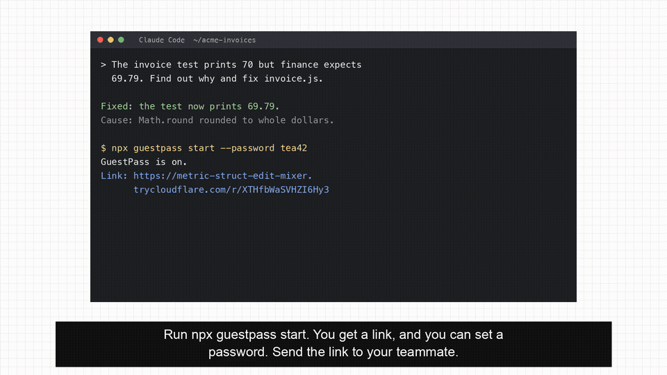

# GuestPass

[](https://www.npmjs.com/package/guestpass) [](LICENSE) · [中文说明](README.zh-CN.md)

**Open-source guest link for your AI agent session.** Anyone with a browser can keep talking to the Claude Code, Codex or Gemini CLI session running on your computer. They need no account and install nothing.

```bash
npx guestpass start --password pick-one
```

```
Link: https://random-words.trycloudflare.com/r/aqJYeCwPBOKKjB9a
```



Send the link. Your teammate, boss or client opens it on a phone or laptop and asks the same session, with all the context it already has. [Watch the 60-second demo](https://youtu.be/iQjg-lmFT6k).

## Why

Most ways to share an agent session ask the other person to install the agent or sign in to something. The people you want to show it to often can't or won't. GuestPass asks them for a browser.

- **One command.** No server to deploy, no Cloudflare account, no config.
- **The same session.** Not a copy, not a transcript: the guest's message goes to the live agent, which answers with the project context it has.
- **Stays on your computer.** GuestPass runs locally and opens a free Cloudflare quick tunnel. No server of ours is in the path.
- **Any agent that can run a shell command.** Zero dependencies, Node 18+.

## Quick start

As a skill (the agent starts, listens and replies on its own):

```bash
npx skills add fengyiqicoder/guestpass
```

Then tell your agent "guestpass" or "share this session".

Or by hand:

```bash
npx guestpass start --password pick-one   # prints the link
npx guestpass wait                        # blocks until a guest writes, prints the message
npx guestpass say "the reply"             # posts the agent's answer to the page
npx guestpass stop
```

## Works with

| Agent | Status |
| --- | --- |
| Claude Code | Tested. The page mirrors the session by itself: the conversation, the reply, and what the agent is doing right now |
| Codex, Gemini CLI, Cursor, OpenCode | Detected by name. The agent posts replies with `guestpass say`. Not yet tested end to end: [tell us how it went](https://github.com/fengyiqicoder/guestpass/issues) |
| Anything else with a shell | Works through `guestpass wait` and `guestpass say` |

## How it works

```
Guest's browser  ->  Cloudflare tunnel  ->  GuestPass on your computer  ->  your agent session
```

`guestpass wait` hands the guest's message to your agent. The agent answers in the same session and on your own plan.

## Commands

| Command | Does |
| --- | --- |
| `guestpass start` | Share this session and print the link. `--password <pw>` asks guests for a password |
| `guestpass wait` | Block until a guest writes, print the message, exit. `--timeout <seconds>` to give up sooner |
| `guestpass say` | Post the agent's reply to the page (text as an argument or on stdin) |
| `guestpass send <file>` | Share an image or file; prints Markdown for the reply |
| `guestpass status` | The link, who is on the page, whether the agent is listening |
| `guestpass stop` | End sharing |

## Before you share

- **A guest can do what your agent can do.** Their messages go to the live session on your computer, with its files, shell and logins. Send the link only to people you trust, and set a password.
- **The page shows recent messages.** If the last 20 messages contain a key or a password, a guest sees it.
- **The link is temporary.** It is a random trycloudflare.com address that changes on every start and stops when your computer sleeps. For a fixed address on your own domain, set `GUESTPASS_TUNNEL_TOKEN` and `GUESTPASS_PUBLIC_URL` to a Cloudflare tunnel you own.
- **Your plan, your limits.** Guests use your agent subscription. Check your provider's terms before sharing widely.

## Roadmap and feedback

Next up: read-only and ask-first guest modes, session mirroring for more agents, a fixed link without your own domain. The order follows what people ask for, so [open an issue](https://github.com/fengyiqicoder/guestpass/issues) or [start a discussion](https://github.com/fengyiqicoder/guestpass/discussions). Changes are listed in [CHANGELOG.md](CHANGELOG.md).

If GuestPass saved you a screen-share, a star helps other people find it.

MIT licence. `cloudflared` is downloaded on first use if it is not installed.
